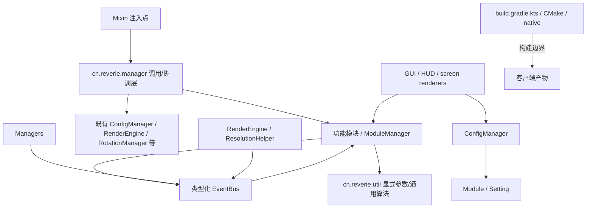

# Nocturne 源码依赖与调用边界

本图只覆盖 `src/main/java/cn/reverie`、`src/main/kotlin/cn/reverie` 中的第一方代码，以及第一方 `buildSrc` / `native`。Gradle 外部依赖版本、旁侧 `launcher-app`、根目录 `net/` 参考源和 vendored ViaFabricPlus 不属于本图。

## 依赖方向

**方向约定：** Mixin 仅依赖 `cn.reverie.manager` 入口、Minecraft 类型及少量事件/Accessor 契约；功能模块、工具与配置/渲染实现不得从 Mixin 直接进入。管理器是薄的时序保持/转发层，业务仍留在既有模块和服务。工具代码不再导入具体功能模块；模块协作仍有若干既有直接边，详见“仍存在的协作边”。

## 第一方包与职责清单

| 包 | 组成/职责 | 主要依赖与调用关系 |
|---|---|---|
| `cn.reverie.manager` | `ClientLifecycleManager`、`PlayerHookManager`、`RotationHookManager`、`InputHookManager`、`NetworkHookManager`、`RenderHookManager`、`WorldHookManager`、`GuiHookManager` | Mixins 的唯一业务入口；按原注入时点串行调用既有模块/服务，并显式维护原功能先后次序。 |
| `cn.reverie.module` | `Module`、`ModuleManager`、`Category`、各 Setting 类型 | `ModuleManager` 是默认模块注册组合根；配置加载改变 `enabled` 后启动对应订阅；输入管理器将按键转给 `ModuleManager.onKey`。 |
| `cn.reverie.module.combat` | `Backtrack`、`BowAim`、`KillAura`、`ProjectileAura`、`Velocity` 及功能模块入口 | 由 `PlayerHookManager` 按原序调用；旋转选择由 `RotationHookManager` 固定为 `Scaffold > KillAura > BowAim > ProjectileAura > BedBreaker`。拆出的功能协作者按模块放在子包：`combat.killaura`、`combat.projectileaura`、`combat.velocity`。 |
| `cn.reverie.module.player` | `AutoMLG`、`AutoTool`、`BedBreaker`、`ChestStealer`、`InvManager`、`Teams` 及功能模块入口 | 客户端生命周期与玩家钩子由管理器调用；背包/攻击等功能复用 `cn.reverie.util` 算法和模块状态。InvManager 拆分协作者位于 `player.invmanager`。 |
| `cn.reverie.module.movement` | `Sprint` | 输入、玩家更新由管理器协调；保留其 omni-sprint 与战斗/脚手架状态判断。 |
| `cn.reverie.module.world` | `Scaffold`、`HumanTellyBridge`、`TimeChanger`、`WeatherChanger` 及功能模块入口 | 玩家、世界、输入管理器转发调用；旋转通用代码通过 `RotationProfile` 查询中立快照，不反向导入模块。Scaffold 的移动、目标计算、放置和轨迹 renderer 位于 `world.scaffold`。 |
| `cn.reverie.module.render` | `Animations`、`BedESP`、`ChatBarModule`、`ChestESP`、`ESP`、`Fullbright`、`NameTags`、`NoHurtCam`、`NotificationModule` 及功能模块入口 | `RenderHookManager` 封装 Mixin 可见的渲染策略；事件驱动渲染订阅跟随模块启停；独立 renderer 位于 `render.animations` 与 `render.esp`。 |
| `cn.reverie.module.misc` | `AccountManagerModule`、`BanTracker`、`Disabler`、`GhostHand`、`YuriGallery` 及功能模块入口 | 生命周期/世界/玩家/输入由管理器调用；按包/模块角色消费网络与渲染事件；Disabler 旋转规则位于 `misc.disabler`。 |
| `cn.reverie.manager.event` | `EventBus`、`EventSubscription`、`Cancellable`；`input.MouseInputEvent`、`packet.PacketEvent` / `PacketSide`、`player.MoveInputEvent`、`render.Render2DEvent` / `RenderHudEvent` / `RenderScreenEvent` / `ResolutionChangeEvent` | `NetworkHookManager` 发布包事件；`GuiHookManager` 发布鼠标事件；`RenderEngine`、`ResolutionHelper` 发布渲染/分辨率事件；事件 payload 提供取消/结果传播。 |
| `cn.reverie.app.config` | `ConfigManager` | 从配置读取模块开关/设置，写入设置变更；不由 Mixin 直接调用。 |
| `cn.reverie.util` | rotation / player / network / render / misc 等通用算法 | 对显式参数、Minecraft 上下文或中立 `RotationProfile` 操作；禁止 import `cn.reverie.module.*`。 |
| `cn.reverie.render` | `core`、`draw`、`font`、`framebuffer`、`hud`、`nanovg`、`shader`、`ui`、`video` | RenderEngine 聚合绘制与 HUD；HUD widgets 消费模块列表/设置；GUI screen 负责输入与设置组件；Mixin 不直接调用这些实现。 |
| `cn.reverie.gui` | click GUI、main menu/login、splash、vanilla list renderers | `GuiHookManager` 管理屏幕路由和 vanilla list renderer；组件通过 Setting API / ConfigManager 操作状态。 |
| `cn.reverie.client` | Fabric `ClientModInitializer` 入口 | 初始化保护启动流程与 splash；启动细节继续委派给 `PackBoot`，不直接持有功能模块依赖。 |
| `cn.reverie.app.command` | CommandManager、命令与实现 | GUI manager 路由命令执行/补全到 CommandManager；命令调用模块/配置服务。 |
| `cn.reverie.app.account` | AccountManager 与账号数据 | ClientLifecycleManager 初始化/保存；AccountManagerScreen 通过账号服务读写。 |
| `cn.reverie.app.music` | CloudMusicManager、API、player、renderer、UI | 音乐功能整体位于 app 域；MusicPlayerModule、HUD、IRC 分享通过音乐服务访问，不由 Mixin 直接调用。 |
| `cn.reverie.nocturne` | Auth、NativeGuard、PackBoot、IRC 等运行时服务 | 启动、鉴权与安全状态；Mixin 层通过生命周期/GUI manager 间接进入。 |
| `buildSrc` / `native` | 混淆构建流水线、CMake 与 native guard | Kotlin Gradle task 通过环境变量/忽略密钥文件把本地密钥传给 CMake，不把密钥写进受跟踪配置或 CMake cache。 |

## Mixin 到功能的关键调用

| 注入域 | Mixin 入口 | 管理器/下游 |
|---|---|---|
| 客户端创建、tick、帧、世界切换、关闭 | `MixinMinecraft` | `ClientLifecycleManager` → `RenderEngine`、配置/账号、`HumanTellyBridge`、玩家工具与模块；原注入时点不变。 |
| LocalPlayer tick / aiStep / motion | `MixinLocalPlayer` | `PlayerHookManager` → `AutoMLG → Scaffold → Velocity.beforeCombat → KillAura → Backtrack → ProjectileAura → BowAim → Disabler → Velocity`；aiStep 顺序同样固定；旋转交由 `RotationHookManager`。 |
| 键盘/移动输入 | `MixinKeyboardHandler`、`MixinKeyboardInput` | `InputHookManager`；移动事件依次给 Scaffold、RotationManager、Sprint、Velocity，最后回写 vanilla Input。 |
| 鼠标、屏幕交互、聊天命令 | `MixinMouseHandler`、`MixinScreen`、聊天/世界/服务器屏幕 mixin | `GuiHookManager` / `RenderHookManager`，随后进入 NvgScreen、列表 renderer、命令服务或 EventBus。 |
| packet send/receive | `MixinConnection` | `NetworkHookManager` → PacketUtil no-event 筛选 → 发布 `PacketEvent` → 订阅者可取消，返回值决定是否 `ci.cancel()`。 |
| 实体、手持物、HUD、光照、渲染 | entity/render/HUD mixins | `RenderHookManager` → ESP、Animations、Fullbright、NameTags、NoHurtCam、ItemSpoofUtil、RenderEngine / Render3DUtil。 |
| 时钟、天气、队伍移除 | world mixins | `WorldHookManager` → TimeChanger、WeatherChanger、Disabler。 |

## 注册、事件生命周期与配置/UI

- `ModuleManager.registerDefaultModules()` 显式维护模块注册清单；每个模块保持单例并由 `Module` 基类托管设置、启用、禁用、脏配置和通知。
- 模块构造期间以 `listen(EventClass::class.java) { ... }` 声明事件订阅工厂。第一次启用时创建订阅，禁用时幂等释放；重复启用不会重复订阅，重启用创建一份新的订阅。全局服务 `BlinkUtil` 的进程级监听仍保持服务生命周期。
- `EventBus.register/subscribe` 返回幂等关闭的 `EventSubscription`。多监听者场景由管理器发布类型化事件；单目标同步钩子仍直接经管理器转发。
- `Setting` 的值变化通知 ConfigManager 标脏；ConfigManager 读写现有格式。ClickGUI/HUD widgets 从 ModuleManager/Setting 读显示状态，用户改值仍走原 Setting callback 和配置管线。

## 仍存在的协作边

为避免机械搬运业务逻辑，目前若干既有模块仍直接查询同领域协作状态，例如 KillAura / ProjectileAura / Scaffold 的互斥与目标交接、Velocity 对 KillAura 攻击结果的复用、AutoTool / InvManager 对 Scaffold/KillAura 的让权、Animations / HUD widgets 读取目标或显示设置。它们不在 Mixin→模块或工具→模块方向上；这些边已纳入后续可逐项迁移到中立战斗/背包状态契约，保留当前优先级和行为。`RotationManager` 与 `GrimRayCastUtil` 已改用中立 `RotationProfile`，不再 import 具体模块。

## 自动检查与长文件拆分

- `architectureCheck` 对 Mixin 的 import/限定名做源码级约束检查，并检查 `cn.reverie.util` 不反向 import feature module；`check` 自动依赖此任务。它不是完整的编译器调用图分析，新增依赖层仍应更新本图并扩展检查。
- 第一方 Kotlin/Java/C/C++/头文件与 Gradle 脚本已按职责拆分；截至本次整理，`src/main`、`buildSrc`、`native` 中未发现超过 500 行的上述源码/构建文件。检查命令可复现此统计：`Get-ChildItem -Path src/main,buildSrc,native -Recurse -File`，按代码扩展名统计行数并筛选 `> 500`。
- 主要拆分落点：
  - ClickGUI：`SettingComponents.kt` 拆成各类型 SettingComponent 与 `ClickGuiOverlays.kt`；`WindowClickGuiScreen.kt` 的绘制移入 `WindowClickGuiRenderer.kt`。
  - 主菜单/列表：主菜单渲染与动效在 `MainMenuScreenRenderer.kt`、`MainMenuScreenEffects.kt`；原版世界/服务器列表拆为 renderer、chrome/content、input、icons 与 entry painters。
  - 战斗/世界模块：KillAura 目标选择、AutoBlock 与攻击预测放在 `module.combat.killaura`；ProjectileAura 轨迹解算放在 `module.combat.projectileaura`；Velocity 的 Hypixel 与 Buffer 策略放在 `module.combat.velocity`；Scaffold 的移动钩子、放置/目标计算及轨迹绘制放在 `module.world.scaffold`。InvManager、Disabler、Animations 与 ESP 的拆分协作者分别位于同名模块子包。
  - UI/HUD/渲染：Login/MainMenu/AccountManager、数组列表与按键 HUD、Toast、视频背景、RenderEngine 的视图/输入/帧协调、VFP 列表图标等按职责拆分。
  - 混淆构建：`FlowPassSupport`、`RenamePassVerifier` 从既有 pass 分离。
- 拆分通过同包内部扩展/专职 renderer/协作者保持调用时序；Mixin 注入点和管理器转发顺序不变。vendored ViaFabricPlus 不拆分。
